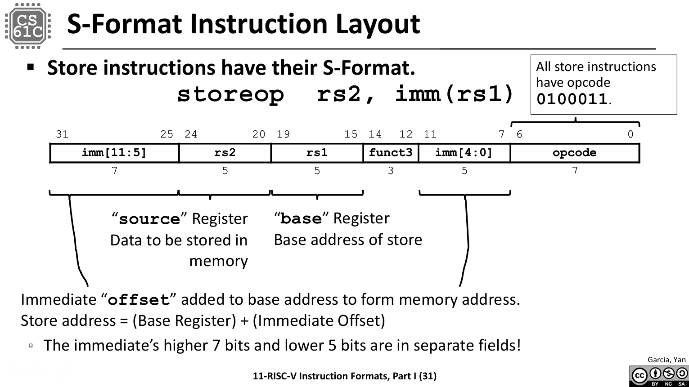
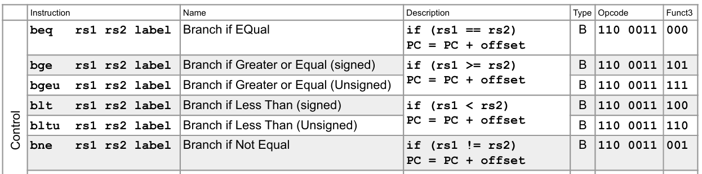
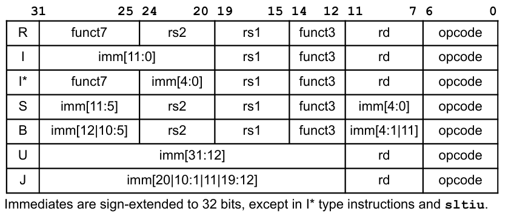
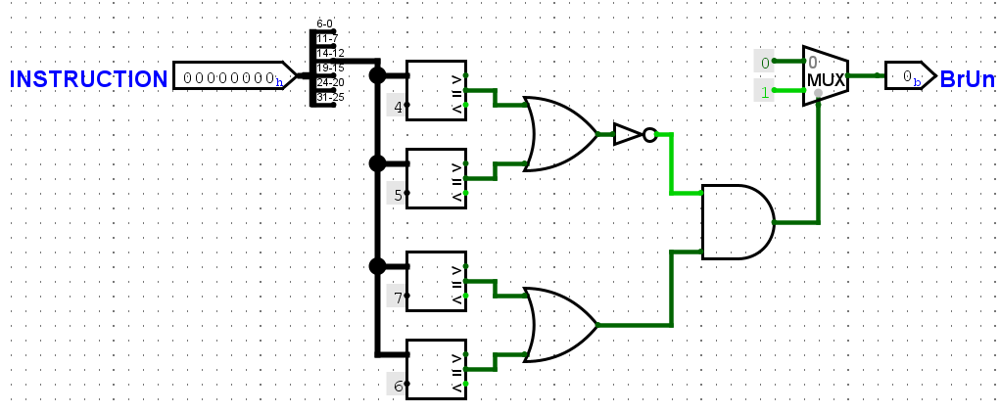
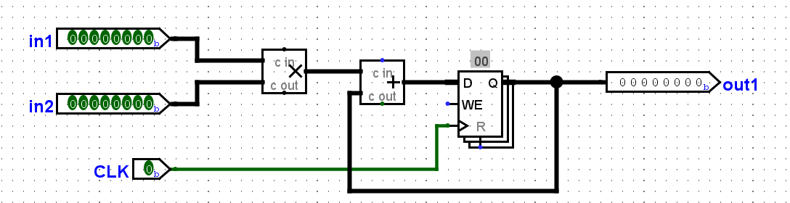
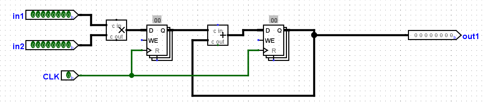

## CS61C Lab 6: CPU, Pipelining

Gary Agasa, Fudan University

### Setup
```bash
java -jar tools/logisim-evolution.jar
```

### Exercise 1: Constructing Immediates
As we have seen in lecture, there are five types of immediates in RISC-V: I-type, S-type, B-type, U-type, and J-type. In this exercise, you will be implementing the S-type immediate generator. `ex1.circ` will take as an input a 32-bit RISC-V store instruction. It should output the sign-extended 32-bit immedate value of the instruction. Constructing the immediate value will require the use of splitters. You can find the summary of how splitters work under the Advanced Logisim Features section in Lab 5.


### Exercise 2: Constructing the BrUn Control Signal
The BrUn control signal is used to tell the branch comparator whether the branch comparison is being performed on signed or unsigned numbers. The following table summarizes the expected value of BrUn.
|Types of Instruction | `BrUn` | Notes |
|---------------------|--------|-------|
|Unsigned branch comparison | 1 | - |
|Signed branch comparison   | 0 | - |
| `beq` or `bne`    | Don't care | The sign of the numbers are not needed when determing if the numbers are equal |
|Non-branch | Don't care | We do not use the output of the branch comparator for non-branch instructions |
 
If the value is listed as "don't care", this means that you can set `BrUn` to `0` or `1`.



### Exercise 3: Inefficiencies Everywhere
For this exercise, we can assume that registers initially carry the value zero. We will be using the lab file `ex3.circ`, which should have a subcircuit called `non_pipelined` which looks something like this:

This circuit simply takes two inputs, multiplies them together, and then adds the result to the current state value. For this circuit, let the propagation delay of an adder block be 45ns and the propagation delay of a multiplication block be 60ns. The register has a CLK-to-Q delay of 10ns, setup time of 10ns, and hold time of 5ns. Assume that both inputs receive their data from registers (so the inputs arrive CLK-to-Q after the rising edge).

**Action Item**
Calculate the length of the critical path of this circuit in ns. Put this number in `ex3.txt` without units.

- Time Parameters:
  - $t_{mult} = 60 ns$
  - $t_{add} = 45 ns$
  - $t_{clk\_to\_q} = 10 ns$
  - $t_{setup} = 5 ns$
  - $t_{hold} = 5ns$

The formula to computing the minimum period $T_{min}$:
$$T_{min} = t_{clk_to_q} + t_{combinational}  +t_{setup}$$
The $t_{combinational}$ is the sum of all the combinational delays along the path.
$$t_{combinational} = t_{mult} + t_{add}$$
**Thus:**
$$t_{combinational} = 60 ns + 45 ns = 105 ns$$
$$T_{min} = 10ns + 105ns + 10ns = 125ns$$
### Exercise 4: Pipe that Line

```
(base) PS C:\Users\wsq\Desktop\26WinterDiy\CS61C\Labs\lab06> python3 test.py
Testing files...
PASSED test: Exercise 1: Immediate Generator
PASSED test: Exercise 2: BrUn
PASSED test: Exercise 4: Pipe that Line
Passed 3/3 tests
```