### CS61C 2020 Fall Lab7: Cache
Gary Agasa

https://web.archive.org/web/20210510074548/https://cs61c.org/fa20/labs/lab07/
****
#### Exercise 1
##### Scenario 1:

###### Program Parameters: (set these by initializing the a registers in the code)
- Array Size (a0): 128 (bytes)
- Step Size (a1): 8
- Rep Count (a2): 4
- Option (a3): 0

###### Cache Parameters: (set these in the Cache tab)
- Cache Levels: 1
- Block Size: 8
- Number of Blocks: 4
- Enable?: Should be green
- Placement Policy: Direct Mapped
- Associativity: 1 (Venus won’t let you change this, why?)
- Block Replacement Policy: LRU

###### Tasks

1. What combination of parameters is producing the hit rate you observe? Write your answer in the form “[parameter A], [parameter B]” where the two parameters complete the following response: “Because [parameter A] in bytes is exactly equal to [parameter B] in bytes.” Note: Don’t forget that ‘cache size’ is a valid parameter that you implicitly set by choosing the block size and the # of blocks.
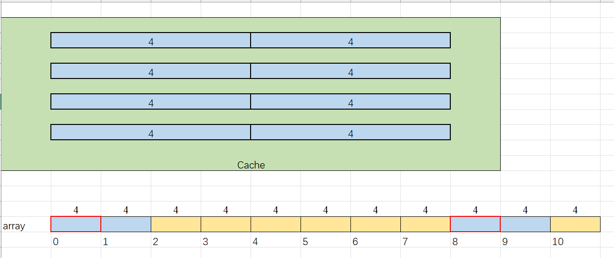
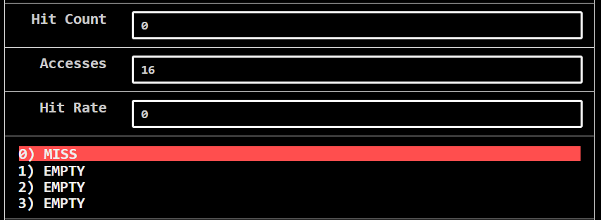
<div style="background-color: #fff8b0; border: 1px solid #ffe066; padding: 10px; border-radius: 5px;">
The hit rate is 0.

Because the step size is 8. We repeatly map the memory to the exactly the same block (index 0).And this cannot cause any hit. Same as we decrease the step size to 4 and 2. 
</div>

2. What is our hit rate if we increase Rep Count arbitrarily? Write your answer as a decimal (e.g. “1.0” if the HR is 100%).

<div style="background-color: #fff8b0; border: 1px solid #ffe066; padding: 10px; border-radius: 5px;">
still 0.0
</div> 

> (**Checkoff Question 1:** Why?)
<div style="background-color: #fff8b0; border: 1px solid #ffe066; padding: 10px; border-radius: 5px;">
I have illustrated above.
</div>

3. How could we modify one program parameter to increase our hit rate? Write your answer in the form “[parameter], [value]” where [parameter] is the program parameter you want to change and [value] is the value you want to change it to. Note: We don’t care if we access the same array elements. Just give us a program parameter modification that would increase the hit rate. However, do make sure that your proposed value is valid. 

<div style="background-color: #fff8b0; border: 1px solid #ffe066; padding: 10px; border-radius: 5px;">
We may change the block size to be 16 byte(4 int) and the number of the block to 2.
At the same time, change the step size to be 1. The hit rate will be approximately 0.75.

</div> 

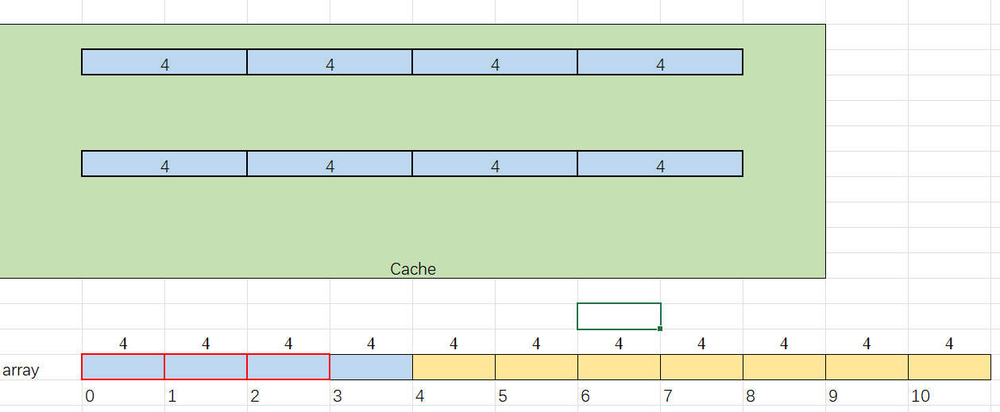
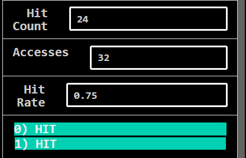
> (**Checkoff Question 2:** There are two program parameters you could’ve changed—can you list both?)

<div style="background-color: #fff8b0; border: 1px solid #ffe066; padding: 10px; border-radius: 5px;">
step size, block size(with block number maybe)
</div> 

##### Scenario 2:
###### Program Parameters: (set these by initializing the a registers in the code)

- Array Size (a0): 256 (bytes)
- Step Size (a1): 2
- Rep Count (a2): 1
- Option (a3): 1

###### Cache Parameters: (set these in the Cache tab)

- Cache Levels: 1
- Block Size: 16
- Number of Blocks: 16
- Enable?: Should be green
- Placement Policy: N-Way Set Associative
- Associativity: 4
- Block Replacement Policy: LRU

###### Tasks
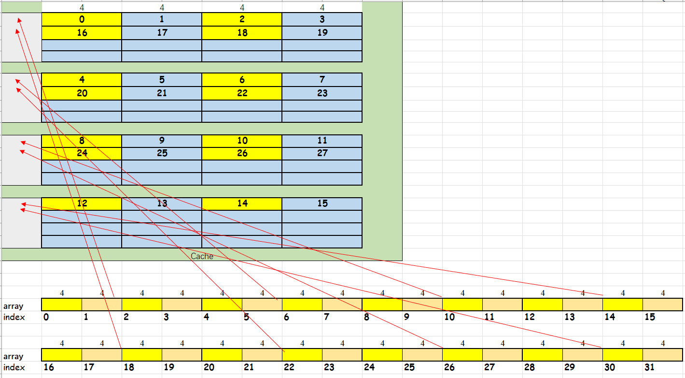

1. How many memory accesses are there per iteration of the inner loop (not the one involving Rep Count)?

<div style="background-color: #fff8b0; border: 1px solid #ffe066; padding: 10px; border-radius: 5px;">
32
</div> 

2. What is the repeating hit/miss pattern? Write your answer in the form “MMHHMH” and so on, where your response is the shortest pattern that gets repeated. 

<div style="background-color: #fff8b0; border: 1px solid #ffe066; padding: 10px; border-radius: 5px;">
MHHH MHHH MHHH MHHH ...
</div> 

> (**Checkoff Question 3:** Why? Now explain the hit rate in terms of the hit/miss pattern.)

<div style="background-color: #fff8b0; border: 1px solid #ffe066; padding: 10px; border-radius: 5px;">
The hit rate is about 75%. Because we choose the method 1(each time write and read once). When we read array[4i + 1], we push the relevant memory to the cache(miss), which we can directly use in writing back array[4i + 1](hit), reading array[4i + 3](hit) and array[4i + 3](hit).
</div> 

3. Keeping everything else the same, what does our hit rate approach as Rep Count goes to infinity? Try it out by changing the appropriate program parameter and letting the code run! Write your answer as a decimal. 
<div style="background-color: #fff8b0; border: 1px solid #ffe066; padding: 10px; border-radius: 5px;">
100%
</div> 

> (**Checkoff Question 4:** Why does this happen?)

<div style="background-color: #fff8b0; border: 1px solid #ffe066; padding: 10px; border-radius: 5px;">
Notice that the cache size is exactly the same as the size of the array.In the first iteration of the outest loop, we have grasped all the memory of the array into the cache, which we can use directly in the following iterations with hitting.
</div> 

You should have noticed that our hit rate was pretty high for this scenario, and your answer to the previous question should give you a good understanding of why. If you are not sure why, consider the size of the array and compare it to the size of the cache. Now, consider the following:

Suppose we have a program that iterates through a very large array (i.e. way bigger than the size of the cache) Rep Count times. During each Rep, we map a different function to the elements of our array (e.g. if Rep Count = 1024, we map 1024 different functions onto each of the array elements, one per Rep). For reference, in this scenario, we just had one function (incrementation) and one Rep.

> **Checkoff Question 5:** Given the program described above, how can we restructure its array accesses to achieve a hit rate like that achieved in this scenario? Assume that each array element is to be modified independently of the others, i.e. it doesn’t matter if Rep k is applied to element arr[i+1] before Rep k is applied to element arr[i], etc.

<div style="background-color: #fff8b0; border: 1px solid #ffe066; padding: 10px; border-radius: 5px;">

HINT: You do not want to iterate through the entire array at once because it’s much bigger than your cache. Doing so would reduce the amount of temporal locality your program exhibits, which makes cache hit rate suffer. We want to exhibit more locality so that our caches can take advantage of our predictable behavior. SO, instead, we should try to access **element** of the array at a time and apply all of the **functions** to that **elements** so we can be completely done with it before moving on, thereby keeping that **element** hot in the cache and not having to circle back to it later on! (The 1st, 3rd, and 4th blanks should be the same. It’s not some vocabulary term you should use to fill them in. It’s more of an idea that you should have.)

</div>

##### Scenario 3:
###### Program Parameters: (set these by initializing the a registers in the code)

- Array Size (a0): 128 (bytes)
- Step Size (a1): 1
- Rep Count (a2): 1
- Option (a3): 0
###### Cache Parameters: (set these in the Cache tab)

- Cache Levels: 2
    
**NOTE: Make sure the following parameters are for the L1 cache!**

(Select L1 in the dropdown right next to the replacement policy)

- Block Size: 8
- Number of Blocks: 8
- Enable?: Should be green
- Placement Policy: Direct Mapped
- Associativity: 1
- Block Replacement Policy: LRU
    
**NOTE: Make sure the following parameters are for the L2 cache!**
 
(Select L2 in the dropdown right next to the replacement policy)

- Block Size: 8
- Number of Blocks: 16
- Enable?: Should be green
- Placement Policy: Direct Mapped
- Associativity: 1
- Block Replacement Policy: LRU

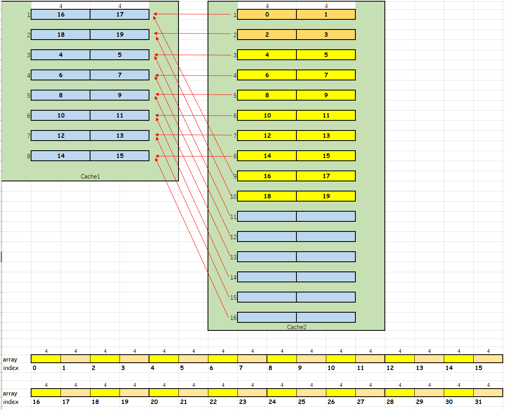

###### Tasks
1. What is the hit rate of our L1 cache? Our L2 cache? Overall? Write your answer in the form “[L1 HR], [L2 HR], [Overall HR]” where each hit rate is a decimal rounded to two places.
    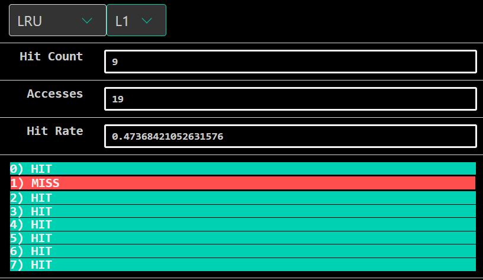
    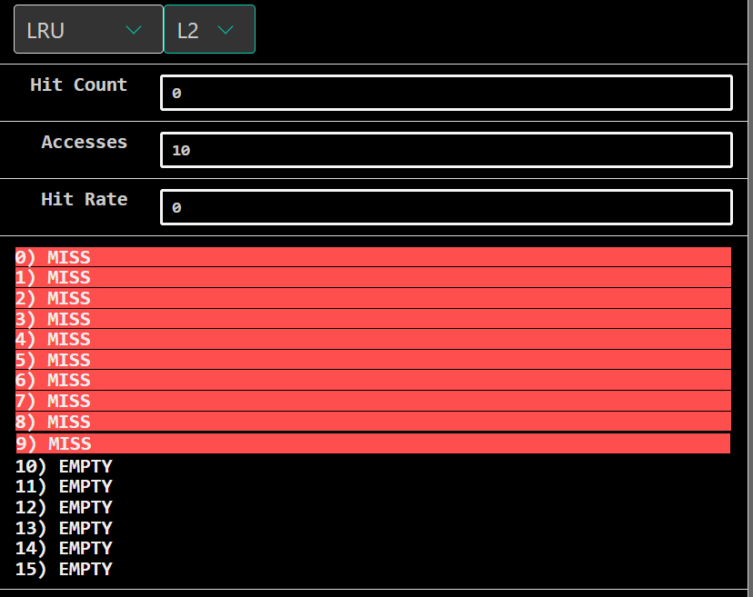

<div style="background-color: #fff8b0; border: 1px solid #ffe066; padding: 10px; border-radius: 5px;">

[L1 HR] 50% = (8 / 16)

[L2 HR] 0% = (0 / 8)

[L3 HR] 33% = ((8 + 0) / (16 + 8))
</div>

2. How many accesses do we have to the L1 cache total? How many of them are misses? Write your answer in the form “[# of L1 accesses], [# of L1 misses]”.

<div style="background-color: #fff8b0; border: 1px solid #ffe066; padding: 10px; border-radius: 5px;">

[# of L1 accesses] 16

[# of L1 misses] 8
</div> 

3. How many accesses do we have to the L2 cache total? HINT: Think about how this relates to the L1 cache (think about what the L1 cache has to do in order to make us access the L2 cache)?

<div style="background-color: #fff8b0; border: 1px solid #ffe066; padding: 10px; border-radius: 5px;">

[# of L2 accesses] 8

[# of L2 misses] 8

That is mainly because from the freezing beginning, each time we **grasp two words into the cache L1 and cache L2 simutaneously**. When we want to access the next word, we can directly get it from the cache L1, without even accessing the cache L2.That's why the access time of the cache L2 is only the half of the cache L1's.
</div> 

4. What program parameter would allow us to increase our L2 hit rate, but keep our L1 hit rate the same? 

<div style="background-color: #fff8b0; border: 1px solid #ffe066; padding: 10px; border-radius: 5px;">
We can change the Rep count to 2.
</div> 

> (**Checkoff Question 6:** Why?)
    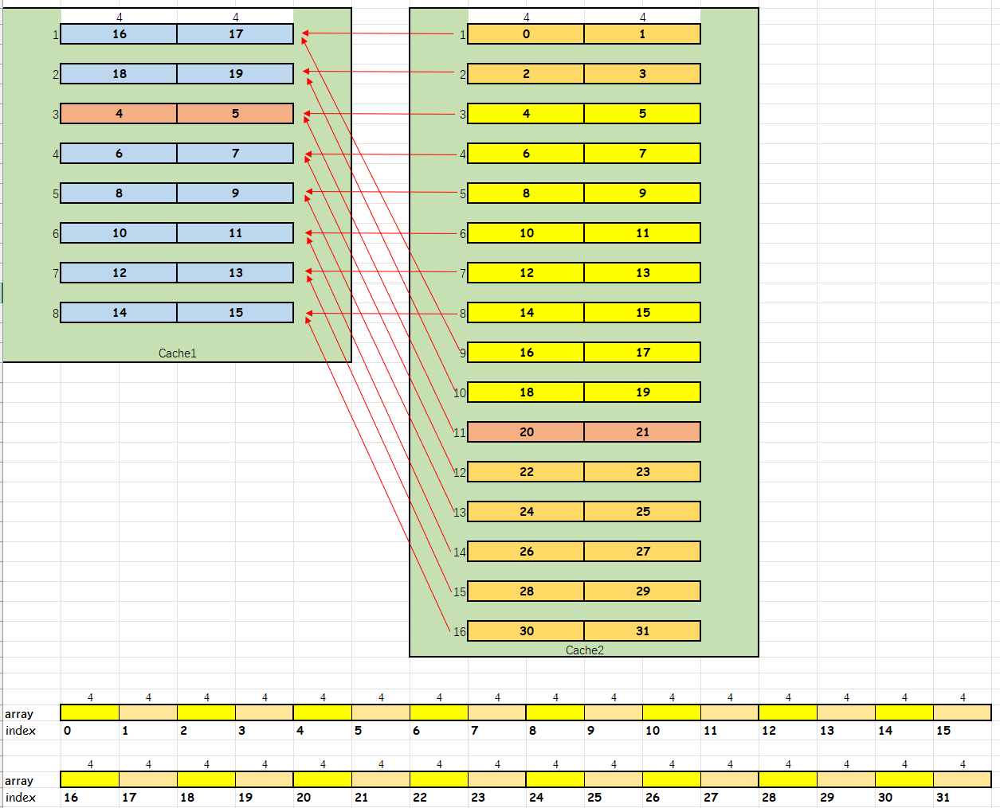
    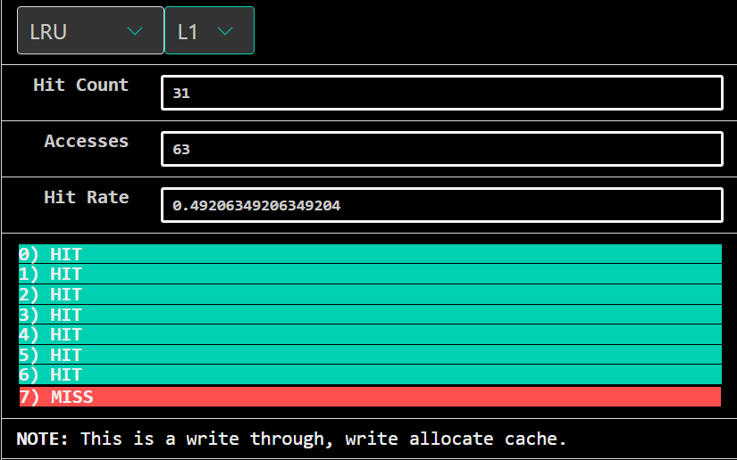
    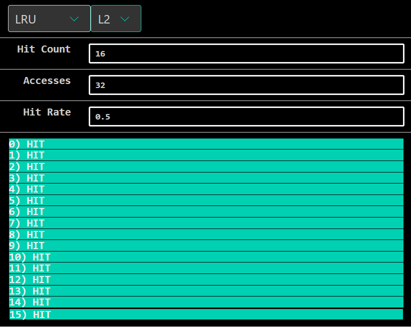

<div style="background-color: #fff8b0; border: 1px solid #ffe066; padding: 10px; border-radius: 5px;">
When we access the array at the second time, because the size of the cache L2 is exactly the same as the size of the array, we can directly get data which is missing at cache L1 from cache L2, then the cache L2 is hit. 
</div> 

5. Do our L1 and L2 hit rates decrease (-), stay the same (=), or increase (+) as we **(1) increase the number of blocks in L1**, or **(2) increase the L1 block size**? Write your answer in the form “[1_L1], [1_L2], [2_L1], [2_L2]” (e.g. if I thought L1 will stay the same for both modifications while L2 will decrease for the first and increase for the second, I would answer “=, -, =, +”).

<div style="background-color: #fff8b0; border: 1px solid #ffe066; padding: 10px; border-radius: 5px;">

[1_L1] =

[1_L2] =

[2_L1] +

[2_L2] =

</div> 

****
#### Exercise 2
```cpp
C[i+j*n] += A[i+k*n]*B[k+j*n];
```

##### Mat1: 
The innermost loop variant is `k`

In the innermost loop:
- moves through B with stride 1
- moves through A with stride n
- moves through C with stride 0
##### Mat2
The innermost loop variant is `j`

In the innnermost loop:
- moves through B with stride n
- moves through A with stride 0
- moves through C with stride n
##### Mat3
The innermost loop variant is `k`

In the innnermost loop:
- moves through B with stride 1
- moves through A with stride n
- moves through C with stride 0
##### Mat4
The innermost loop variant is `i`

In the innnermost loop:
- moves through B with stride 0
- moves through A with stride 1
- moves through C with stride 1
##### Mat5
The innermost loop variant is `j`

In the innnermost loop:
- moves through B with stride n
- moves through A with stride 0
- moves through C with stride n
##### Mat6
The innermost loop variant is `i`

In the innnermost loop:
- moves through B with stride 0
- moves through A with stride 1
- moves through C with stride 1

```bash
gary@LAPTOP-1P7N3FS9:/mnt/e/26WinterDiy/CS61C/Labs/lab07$ make ex2
gcc -o matrixMultiply -ggdb -Wall -pedantic -std=gnu99 -O3 matrixMultiply.c     
./matrixMultiply
ijk:    n = 1000, 4.528 Gflop/s
ikj:    n = 1000, 1.366 Gflop/s
jik:    n = 1000, 4.427 Gflop/s
jki:    n = 1000, 24.360 Gflop/s
kij:    n = 1000, 1.366 Gflop/s
kji:    n = 1000, 20.768 Gflop/s
```

##### Tasks
1. Which 2 orderings perform best for these 1000-by-1000 matrices? Write your answer in the form “[Ordering1], [Ordering2]” (e.g. “ijk, ikj”). 

<div style="background-color: #fff8b0; border: 1px solid #ffe066; padding: 10px; border-radius: 5px;">
jki, kji
</div> 

> (**Checkoff Quesion 1**: Why?)

<div style="background-color: #fff8b0; border: 1px solid #ffe066; padding: 10px; border-radius: 5px;">
The innerest loop variant is i

In the innnermost loop:

- moves through B with stride 0

- moves through A with stride 1

- moves through C with stride 1
</div> 

2. Which 2 orderings perform the worst?

<div style="background-color: #fff8b0; border: 1px solid #ffe066; padding: 10px; border-radius: 5px;">
ikj, kij
</div>  

> (**Checkoff Question 2**: Why?)
<div style="background-color: #fff8b0; border: 1px solid #ffe066; padding: 10px; border-radius: 5px;">
The innermost loop variant is j

In the innnermost loop:
- moves through B with stride n
- moves through A with stride 0
- moves through C with stride n
</div> 

> **Checkoff Question 3**: How does the way we stride through the matrices with respect to the innermost loop affect performance?
<div style="background-color: #fff8b0; border: 1px solid #ffe066; padding: 10px; border-radius: 5px;">
In the innerest loop, the less we stride for each iteration, the better the performance is.
</div> 

****

#### Exercise 3 Cache Blocking and Matrix Transposition

##### Part 1 - Changing Array Sizes
Fix the `blocksize` to be 20, and run your code with `n` equal to 100, 1000, 2000, 5000, and 10000. 
```bash
gary@LAPTOP-1P7N3FS9:/mnt/e/26WinterDiy/CS61C/Labs/lab07$ ./transpose 100 20
Testing naive transpose: 0.002 milliseconds
Testing transpose with blocking: 0.005 milliseconds
```
```bash
gary@LAPTOP-1P7N3FS9:/mnt/e/26WinterDiy/CS61C/Labs/lab07$ ./transpose 1000 20
Testing naive transpose: 0.691 milliseconds
Testing transpose with blocking: 0.456 milliseconds
```
```bash
gary@LAPTOP-1P7N3FS9:/mnt/e/26WinterDiy/CS61C/Labs/lab07$ ./transpose 2000 20
Testing naive transpose: 9.676 milliseconds
Testing transpose with blocking: 3.202 milliseconds
```
```bash
gary@LAPTOP-1P7N3FS9:/mnt/e/26WinterDiy/CS61C/Labs/lab07$ ./transpose 5000 20
Testing naive transpose: 121.426 milliseconds
Testing transpose with blocking: 20.893 milliseconds
```
```bash
gary@LAPTOP-1P7N3FS9:/mnt/e/26WinterDiy/CS61C/Labs/lab07$ ./transpose 10000 20
Testing naive transpose: 587.771 milliseconds
Testing transpose with blocking: 99.684 milliseconds
```
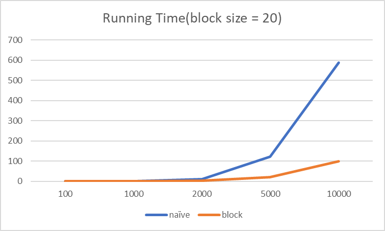

> **Checkoff Question 1:** At what point does cache blocked version of transpose become faster than the non-cache blocked version?

<div style="background-color: #fff8b0; border: 1px solid #ffe066; padding: 10px; border-radius: 5px;">
When n >= 1000  
</div>

> **Checkoff Question 2:** Why does cache blocking require the matrix to be a certain size before it outperforms the non-cache blocked code?

<div style="background-color: #fff8b0; border: 1px solid #ffe066; padding: 10px; border-radius: 5px;">
When the size of matrix is small, that means just transpose the matrix itself directly can have a nice locality enough, without the need of blocking. On the contrary, there are more operations to perform in the blocking method which could be not worthy when `n` is too small.
</div>


##### Part 2 - Changing Blocksize
Fix `n` to be 10000, and run your code with `blocksize` equal to 50, 100, 500, 1000, 5000. 
```bash
gary@LAPTOP-1P7N3FS9:/mnt/e/26WinterDiy/CS61C/Labs/lab07$ ./transpose 10000 2
Testing naive transpose: 589.34 milliseconds
Testing transpose with blocking: 299.955 milliseconds
```
```bash
gary@LAPTOP-1P7N3FS9:/mnt/e/26WinterDiy/CS61C/Labs/lab07$ ./transpose 10000 5
Testing naive transpose: 582.59 milliseconds
Testing transpose with blocking: 176.986 milliseconds
```
```bash
gary@LAPTOP-1P7N3FS9:/mnt/e/26WinterDiy/CS61C/Labs/lab07$ ./transpose 10000 50
Testing naive transpose: 600.635 milliseconds
Testing transpose with blocking: 81.188 milliseconds
```
```bash
gary@LAPTOP-1P7N3FS9:/mnt/e/26WinterDiy/CS61C/Labs/lab07$ ./transpose 10000 100
Testing naive transpose: 594.498 milliseconds
Testing transpose with blocking: 76.023 milliseconds
```
```bash
gary@LAPTOP-1P7N3FS9:/mnt/e/26WinterDiy/CS61C/Labs/lab07$ ./transpose 10000 500
Testing naive transpose: 598.593 milliseconds
Testing transpose with blocking: 83.749 milliseconds
```
```bash
gary@LAPTOP-1P7N3FS9:/mnt/e/26WinterDiy/CS61C/Labs/lab07$ ./transpose 10000 1000
Testing naive transpose: 602.01 milliseconds
Testing transpose with blocking: 103.852 milliseconds
```
```bash
gary@LAPTOP-1P7N3FS9:/mnt/e/26WinterDiy/CS61C/Labs/lab07$ ./transpose 10000 5000
Testing naive transpose: 589.215 milliseconds
Testing transpose with blocking: 436.367 milliseconds
```
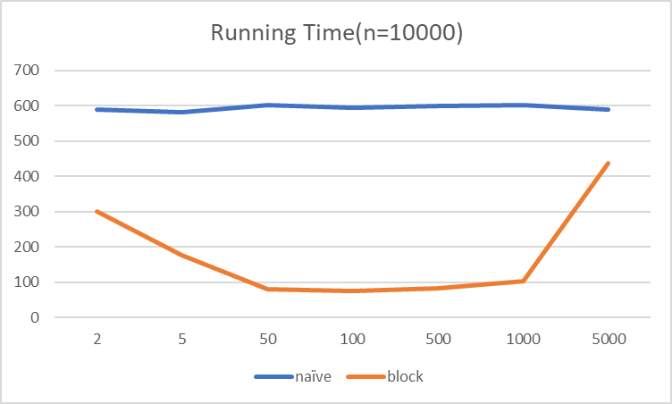
> **Checkoff Question 3:** How does performance change as blocksize increases? Why is this the case?
*(Sanity check: as you increase blocksize, the amount of speedup should change in one direction, then change in the other direction.)*
<div style="background-color: #fff8b0; border: 1px solid #ffe066; padding: 10px; border-radius: 5px;">
The running time of the blocking method decreases at first and then increases, reaching its best performance at `100` when the runnning time is 76.023 milliseconds.

That means that the cache size should be appropriate. If the cache size is too big or too small, we will both lose the good locality.
</div>
