## CS61C 2025 Fall Project 3 CS61C CPU

Gary Agasa, Fudan University

### Setup
https://web.archive.org/web/20251210112914/https://cs61c.org/fa25/projects/proj3

download Venus and Logisim

```bash
bash test.sh download_tools
```

Launch Venus
```bash
java -jar tools/logisim-evolution.jar
```
### Testing
```bash
To download Logisim & Venus: bash test.sh download_tools
Part A:
    All part A tests:       bash test.sh part_a
    ALU:                    bash test.sh test_alu
    RegFile:                bash test.sh test_regfile
    addi:                   bash test.sh test_addi

Part B - All Tests:         bash test.sh part_b
Part B - Unit Tests:
    Branch comparator:      bash test.sh test_branch_comp
    Immediate generator:    bash test.sh test_imm_gen
    Partial load:           bash test.sh test_partial_load
    Partial store:          bash test.sh test_partial_store
Part B - Integration Tests (not comprehensive):
    Registers:              bash test.sh test_integration_all_regs
    Branches:               bash test.sh test_integration_branch
    Immediates:             bash test.sh test_integration_immediates
    Jumps:                  bash test.sh test_integration_jump
    lui:                    bash test.sh test_integration_lui
    Memory:                 bash test.sh test_integration_mem
    Basic programs:         bash test.sh test_integration_programs
Part B - Custom Tests:
    Create and run custom tests:    bash test.sh test_custom
    To only create custom tests:    bash test.sh create_custom
    To only run custom tests:       bash test.sh run_custom
Part B - Pipelined:
    Add --pipelined after any command above
    Example: bash test.sh run_custom --pipelined
```
If you fail a test, the test runner will print the difference between the expected and actual output. To view the complete reference output (.ref file) and your output (.out file), you can use run bash test.sh format with the name of the output file. For example, in **Part A Task 1**:
```bash
bash test.sh format tests/unit-alu/out/alu-add.ref
bash test.sh format tests/unit-alu/out/alu-add.out

bash test.sh format tests/unit-alu/out/alu-all.ref
bash test.sh format tests/unit-alu/out/alu-all.out

bash test.sh format tests/unit-alu/out/alu-logic.ref
bash test.sh format tests/unit-alu/out/alu-logic.out

bash test.sh format tests/unit-alu/out/alu-mult.ref
bash test.sh format tests/unit-alu/out/alu-mult.out

bash test.sh format tests/unit-alu/out/alu-shift.ref
bash test.sh format tests/unit-alu/out/alu-shift.out

bash test.sh format tests/unit-alu/out/alu-slt-sub-bsel.ref
bash test.sh format tests/unit-alu/out/alu-slt-sub-bsel.out
```
### Part A. addi
In this part, you will design a skeleton CPU that can execute the addi instruction.
#### Task 1: Arithmetic Logic Unit (ALU)
| ALUSel Value | Instruction |
|--------------|-------------|
| 0  | add: Result = A + B |
| 1  | sll: Result = A << B[4:0] |
| 2  | slt: Result = (A < B (signed)) ? 1 : 0 |
| 3  | Unused |
| 4  | xor: Result = A ^ B |
| 5  | srl: Result = (unsigned) A >> B[4:0] |
| 6  | or: Result = A \| B |
| 7  | and: Result = A & B |
| 8  | mul: Result = (signed) (A * B)[31:0] |
| 9  | mulh: Result = (signed) (A * B)[63:32] |
| 10 | Unused |
| 11 | mulhu: Result = (A * B)[63:32] |
| 12 | sub: Result = A - B |
| 13 | sra: Result = (signed) A >> B[4:0] |
| 14 | Unused |
| 15 | bsel: Result = B |

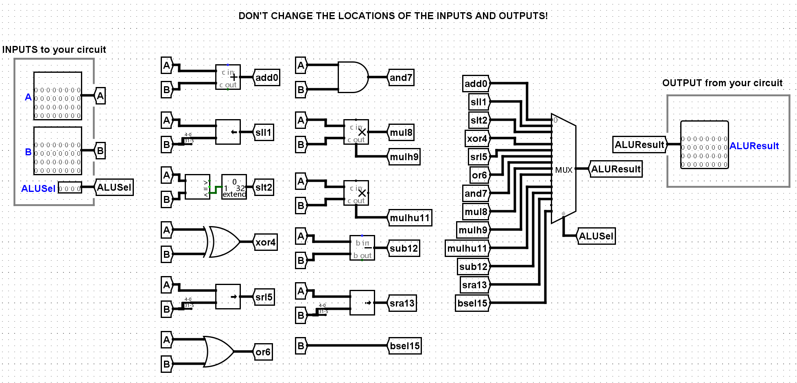

Test: `bash test.sh test_alu`
```bash
(base) PS C:\Users\wsq\Desktop\26WinterDiy\CS61C\Projects\proj3_fa25> bash test.sh test_alu
PASS: tests/unit-alu/alu-add.circ
PASS: tests/unit-alu/alu-all.circ
PASS: tests/unit-alu/alu-logic.circ
PASS: tests/unit-alu/alu-mult.circ
PASS: tests/unit-alu/alu-shift.circ
PASS: tests/unit-alu/alu-slt-sub-bsel.circ
Passed 6/6 tests
```
#### Task 2: Register File
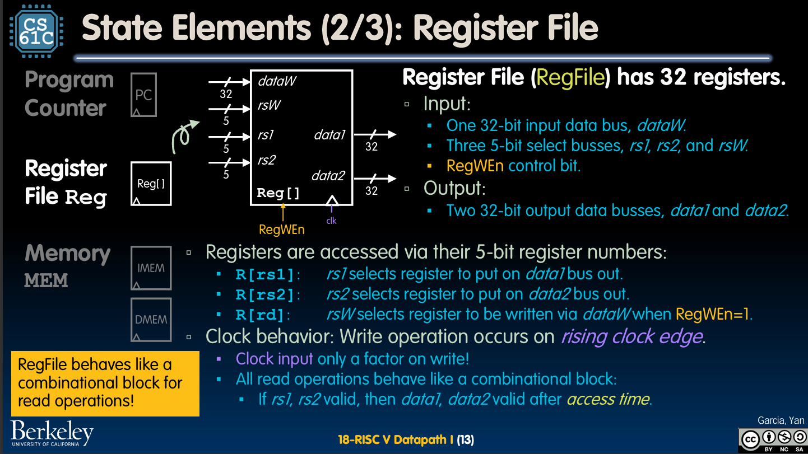
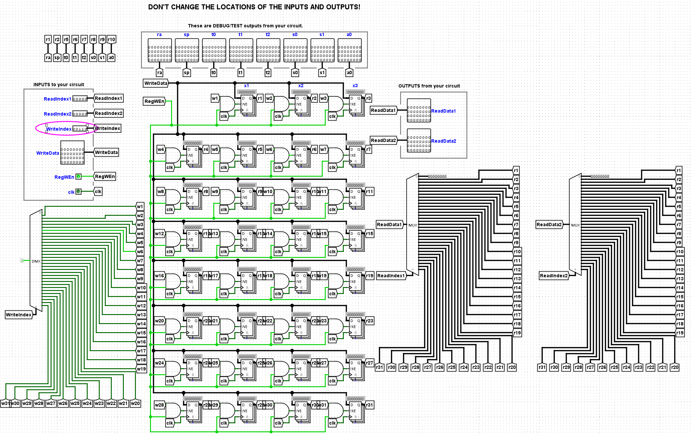
##### Registers
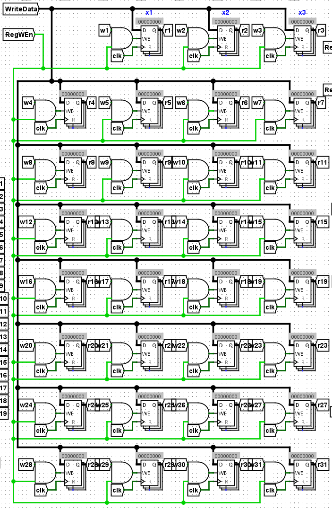
##### ReadData Selection
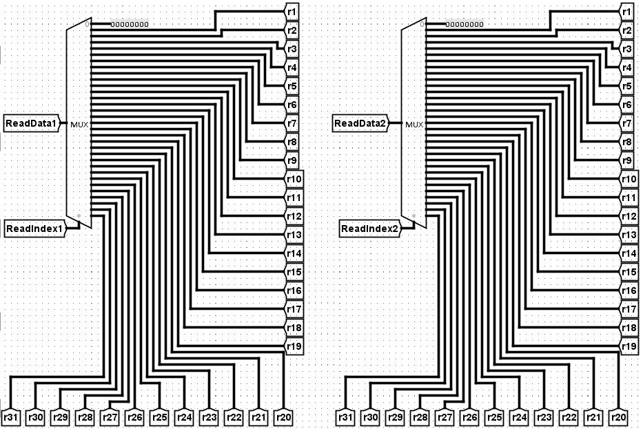
Here $r_i$ are 32-bit ports, transfersing the data from the register to the **ReadData** ports. 
##### Write Enable Selection
> **Notice:**
> At any time, there is **at most 1 register** that can be written to while others should be strictly banned. In other words, there is at most only one $w_i$($0 \leq i \leq 31 $) is 1 and $w_j$($0 \leq j \leq 31, i \neq j$) is 0(one-hot encoding). Here $w_i$ are 1-bit ports.
> So only when the **RegWEn** is 1 ***and*** the corresponding **$w_i$** is 1 should we write to the `x_i` register.
    
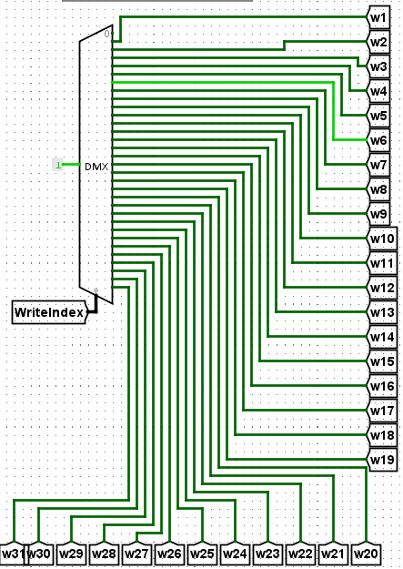
```
(base) PS C:\Users\wsq\Desktop\26WinterDiy\CS61C\Projects\proj3_fa25> bash test.sh test_regfile
PASS: tests/unit-regfile/regfile-more-regs.circ
PASS: tests/unit-regfile/regfile-read-only.circ
PASS: tests/unit-regfile/regfile-read-write.circ
PASS: tests/unit-regfile/regfile-x0.circ
Passed 4/4 tests
```
#### Task 3: Immediate Generator
For the rest of Part A, we will be creating just enough of the CPU to execute the addi instruction. In Part B, you will revisit these circuits and expand them to support more instructions.

Fill in the immediate generator in `imm-gen.circ` (not the `imm_gen` subcircuit in `cpu.circ`) so that it can generate immediates for the `addi` instruction. You can ignore other immediate types for now.

|Input Name	| Bit Width | Description |
|-----------|------------------------|----------|
|Instruction| 32	|The instruction being executed|
|ImmSel	| 3	| Value determining how to reconstruct the immediate (you can ignore this for now)|

|Output Name|	Bit Width|	Description|
|-----------|------------|-------------|
|Immediate	|32|	Value of the immediate in the instruction (assume the instruction is addi for now)|

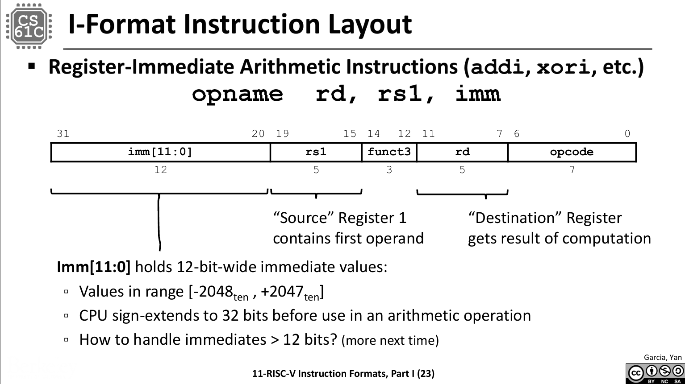
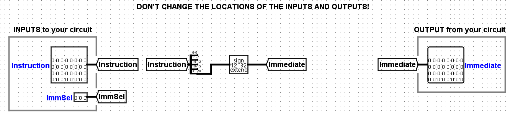

#### Task 4: Datapath
Fill in `cpu.circ` so that it contains a datapath for a single-cycle processor that can execute the `addi` instruction.
##### Input
| Input Name  | Bit Width | Description                                        |
| ----------- | --------- | -------------------------------------------------- |
| MemReadData | 32        | Data at `MemAddress` from memory                   |
| Instruction | 32        | The instruction at memory address `ProgramCounter` |
| clk         | 1         | Clock input                                        |
##### Output
| Output Name    | Bit Width | Description                                      |
| -------------- | --------- | ------------------------------------------------ |
| ra             | 32        | The value of ra (x1)                             |
| sp             | 32        | The value of sp (x2)                             |
| t0             | 32        | The value of t0 (x5)                             |
| t1             | 32        | The value of t1 (x6)                             |
| t2             | 32        | The value of t2 (x7)                             |
| s0             | 32        | The value of s0 (x8)                             |
| s1             | 32        | The value of s1 (x9)                             |
| a0             | 32        | The value of a0 (x10)                            |
| MemAddress     | 32        | The address in memory to read from or write to   |
| MemWriteData   | 32        | Data to write to memory                          |
| MemWriteMask   | 4         | The write enable mask for writing data to memory |
| ProgramCounter | 32        | Address of the `Instruction` input|

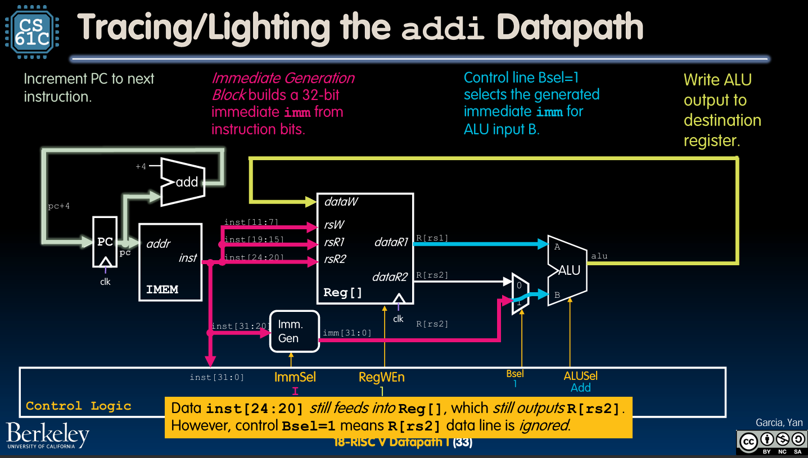
##### Task 4.1 Instruction Fetch
We have already provided a simple implementation of the program counter. It is a 32-bit register that increments by 4 on each clock cycle. The `ProgramCounter` is connected to IMEM (instruction memory), and the `Instruction` is returned from IMEM.
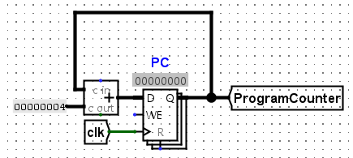
##### Task 4.2 Instruction Decode
In this step, we need to break down the Instruction input and send the bits to the right subcircuits.
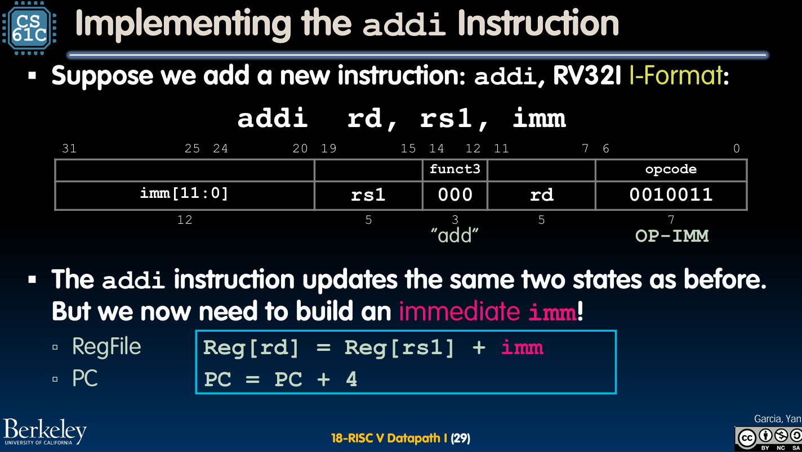

##### Task 4.3 Execute
In this step, we will use the decoded instruction fields to compute the actual instruction.
##### Task 4.4 Memory
The `addi` instruction doesn't use memory, so there's nothing for you to implement in this sub-task!

The memory stage is where the memory can be written to using store instructions and read from using load instructions. Because the `addi` instruction does not use memory, we do not have to worry about it for Part A. Please ignore the DMEM and leave its I/O pins undriven.
##### Task 4.5 Write Back
In this step, we will write the result of our addi instruction back into a register.
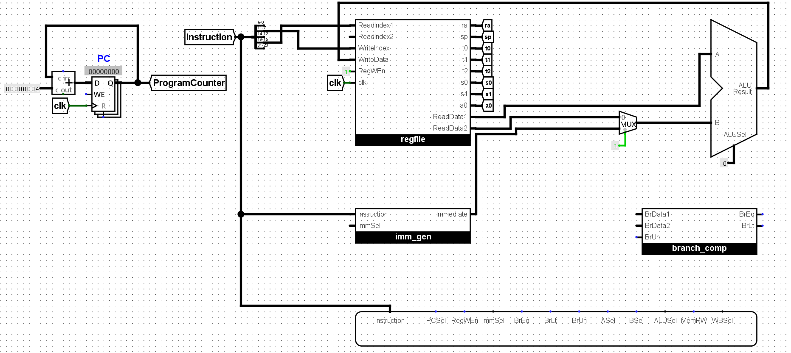
```
(base) PS C:\Users\wsq\Desktop\26WinterDiy\CS61C\Projects\proj3_fa25> bash test.sh test_addi
PASS: tests/integration-addi/addi-basic.circ
PASS: tests/integration-addi/addi-negative.circ
PASS: tests/integration-addi/addi-positive.circ
Passed 3/3 tests
```

### Part B. More Instructions
**Control Logic**
The control logic subcircuit takes the instruction bits and outputs all the control signals needed to execute that instruction. Here is a summary of the control signals you should implement:
| Signal | Bit Width | Purpose |
|-------|-----------|---------|
| PCSel | 1 | Selects the ALU input for all B-type instructions where the branch is taken (according to the branch comparator output) and all jumps. Selects the PC+4 input for all other instructions. |
| ImmSel | 3 | Selects the instruction format so the immediate generator can extract the immediate correctly. The default encoding is `[0b000 = I]`, `[0b001 = S]`, `[0b010 = B]`, `[0b011 = U]`, `[0b100 = J]`, though you're welcome to pick your own (see below). |
| RegWEn | 1 | 1 if the instruction writes to a register, and 0 otherwise. |
| BrUn | 1 | 1 if the branch instruction is unsigned, and 0 if the branch instruction is signed. Don't care for all other instructions. |
| ASel | 1 | Selects whether to send the data in `RegReadData1` or the PC to the ALU. |
| BSel | 1 | Selects whether to send the data in `RegReadData2` or the immediate to the ALU. |
| ALUSel | 4 | Selects the correct operation for the ALU. See Task 1 for the mapping of `ALUSel` values to operations. |
| MemRW | 1 | 1 if the instruction writes to memory, and 0 otherwise. |
| WBSel | 2 | Selects whether to write the memory read from DMEM, the ALU output, or PC+4 to `rd`. |

#### Task 5: I-type Instructions
| Instruction           | Type | Opcode | Funct3 | Funct7 | Operation                                   |
|-----------------------|------|--------|--------|--------|---------------------------------------------|
| `addi rd, rs1, imm`     | I    | 0x13   | 0x0    |        | rd = rs1 + imm                              |
| `andi rd, rs1, imm`     | I    | 0x13   | 0x7    |        | rd = rs1 & imm                              |
| `ori rd, rs1, imm`      | I    | 0x13   | 0x6    |        | rd = rs1 \| imm                             |
| `xori rd, rs1, imm`     | I    | 0x13   | 0x4    |        | rd = rs1 ^ imm                              |
| `slli rd, rs1, imm`     | I*   | 0x13   | 0x1    | 0x00   | rd = rs1 << imm                             |
| `srli rd, rs1, imm`     | I*   | 0x13   | 0x5    | 0x00   | rd = rs1 >> imm (Zero-extend)               |
| `srai rd, rs1, imm`     | I*   | 0x13   | 0x5    | 0x20   | rd = rs1 >> imm (Sign-extend)               |
| `slti rd, rs1, imm`     | I    | 0x13   | 0x2    |        | rd = (rs1 < imm) ? 1 : 0                   |
```
gary@LAPTOP-1P7N3FS9:/mnt/c/Users/wsq/Desktop/26WinterDiy/CS61C/Projects/proj3_fa25$ bash test.sh test_custom
...
PASS: tests/integration-custom/andi.circ
PASS: tests/integration-custom/ori.circ
PASS: tests/integration-custom/slli.circ
PASS: tests/integration-custom/slti.circ
PASS: tests/integration-custom/srai.circ
PASS: tests/integration-custom/srli.circ
PASS: tests/integration-custom/xori.circ
Passed 7/7 tests
```
#### Task 6: R-type Instructions
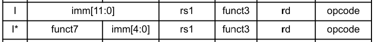

| Instruction | Type | Opcode | Func3 | Func7 | Operation |
|-------------|------|--------|-------|-------|-----------|
| `add rd, rs1, rs2` | R | 0x33 | 0x0 | 0x00 | rd = rs1 + rs2 |
| **`sub rd, rs1, rs2`** | R | 0x33 | 0x0 | 0x20 | rd = rs1 - rs2 |
| `and rd, rs1, rs2` | R | 0x33 | 0x7 | 0x00 | rd = rs1 & rs2 |
| `or rd, rs1, rs2` | R | 0x33 | 0x6 | 0x00 | rd = rs1 | rs2 |
| `xor rd, rs1, rs2` | R | 0x33 | 0x4 | 0x00 | rd = rs1 ^ rs2 |
| `sll rd, rs1, rs2` | R | 0x33 | 0x1 | 0x00 | rd = rs1 << rs2 |
| `srl rd, rs1, rs2` | R | 0x33 | 0x5 | 0x00 | rd = rs1 >> rs2 **(Zero-extend)** |
| `sra rd, rs1, rs2` | R | 0x33 | 0x5 | 0x20 | rd = rs1 >> rs2 **(Sign-extend)** |
| `slt rd, rs1, rs2` | R | 0x33 | 0x2 | 0x00 | rd = (rs1 < rs2) ? 1 : 0 |
| **`mul rd, rs1, rs2`** | R | 0x33 | 0x0 | 0x01 | rd = (rs1 * rs2)[31:0] |
| **`mulh rd, rs1, rs2`** | R | 0x33 | 0x1 | 0x01 | rd = (rs1 * rs2)[63:32] **(Signed)** |
| **`mulhu rd, rs1, rs2`** | R | 0x33 | 0x3 | 0x01 | rd = (rs1 * rs2)[63:32] **(Unsigned)**|

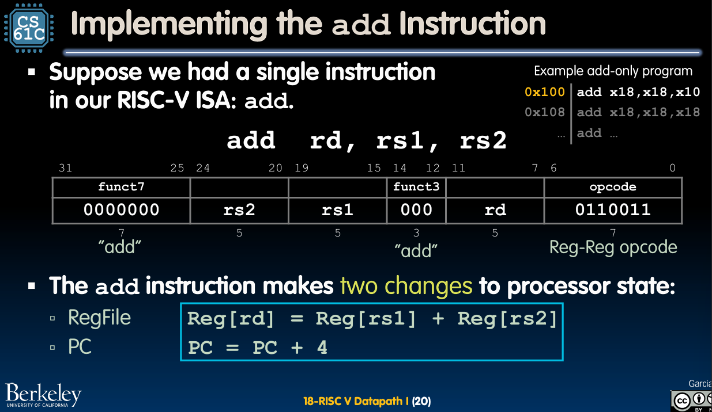
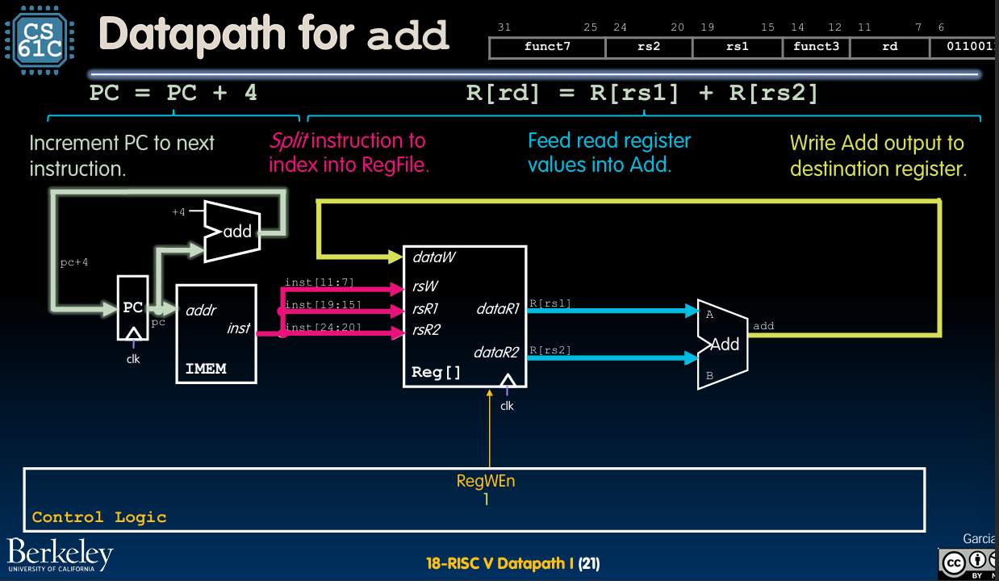
##### CPU
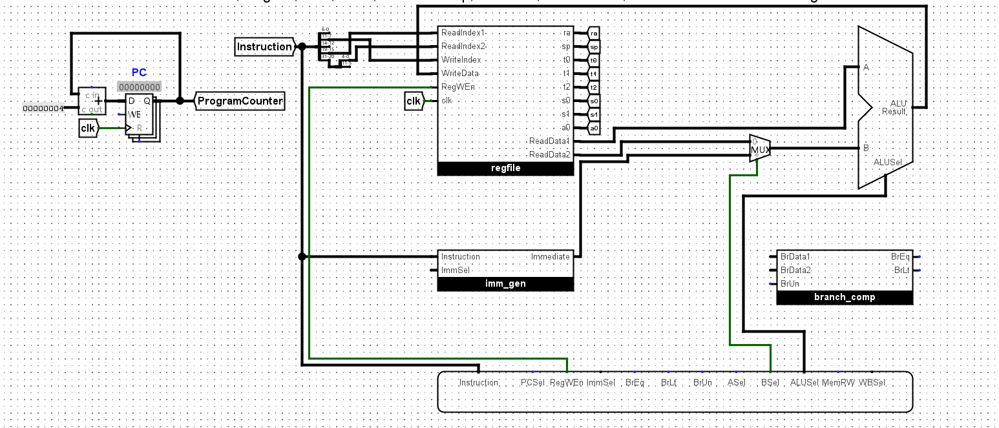
##### Control Logic
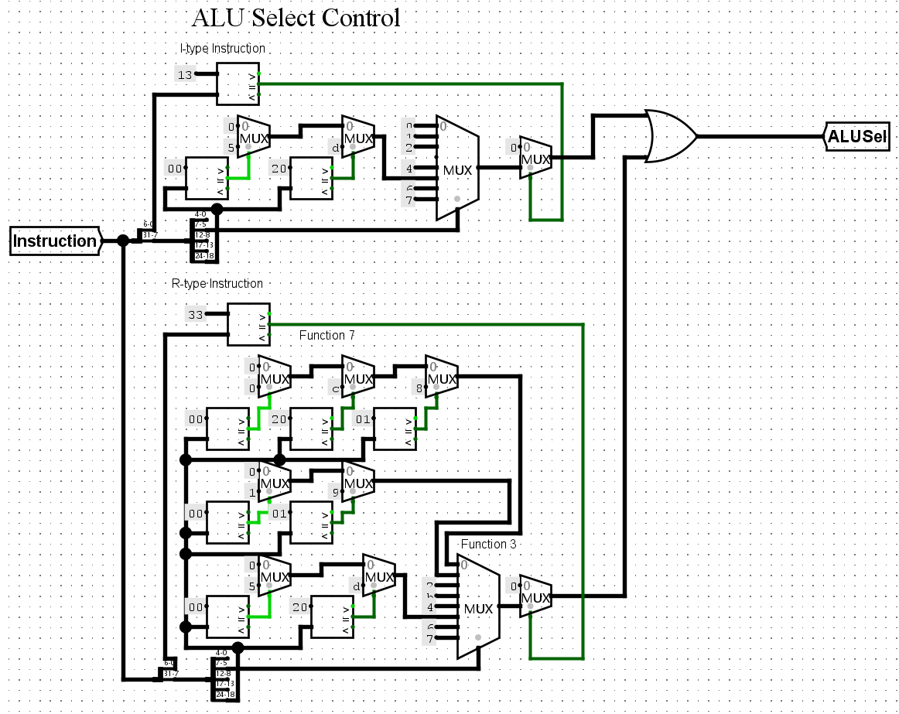
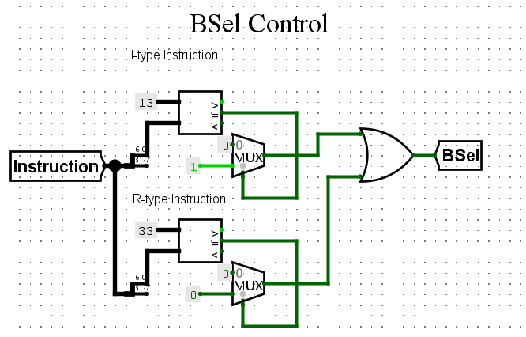
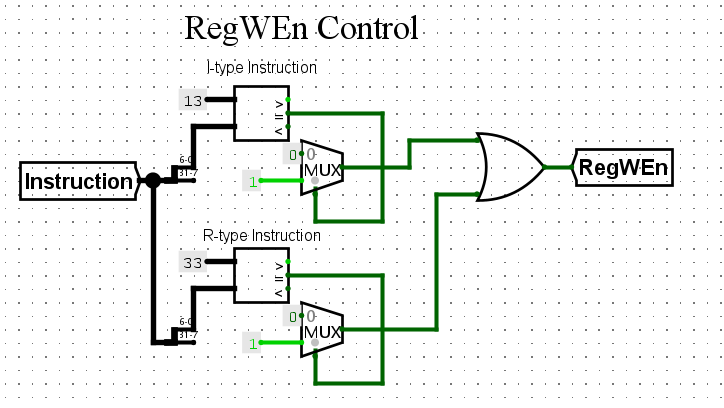
```
PASS: tests/integration-custom/add.circ
PASS: tests/integration-custom/and.circ
PASS: tests/integration-custom/andi.circ
PASS: tests/integration-custom/mul.circ
PASS: tests/integration-custom/mulh.circ
PASS: tests/integration-custom/mulhu.circ
PASS: tests/integration-custom/or.circ
PASS: tests/integration-custom/ori.circ
PASS: tests/integration-custom/sll.circ
PASS: tests/integration-custom/slli.circ
PASS: tests/integration-custom/slt.circ
PASS: tests/integration-custom/slti.circ
PASS: tests/integration-custom/sra.circ
PASS: tests/integration-custom/srai.circ
PASS: tests/integration-custom/srl.circ
PASS: tests/integration-custom/srli.circ
PASS: tests/integration-custom/sub.circ
PASS: tests/integration-custom/xor.circ
PASS: tests/integration-custom/xori.circ
Passed 19/19 tests
```
#### Task 7: B-type Instructions
##### Branch Comparator
| Signal Name | Direction | Bit Width | Description |
|------------|-----------|-----------|-------------|
| BrData1    | Input     | 32        | First value to compare |
| BrData2    | Input     | 32        | Second value to compare |
| BrUn       | Input     | 1         | 1 when an **unsigned** comparison is wanted, and 0 when a **signed** comparison is wanted |
| BrEq       | Output    | 1         | Set to 1 if the two values are equal |
| BrLt       | Output    | 1         | Set to 1 if the value in rs1 is less than the value in rs2 |

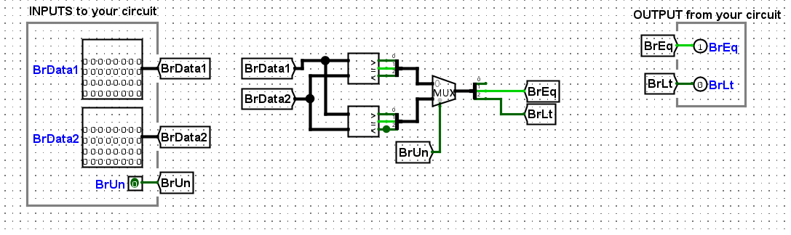
```
(base) PS C:\Users\wsq\Desktop\26WinterDiy\CS61C\Projects\proj3_fa25> bash test.sh test_branch_comp
PASS: tests/unit-branch-comp/branch-comp-all.circ
PASS: tests/unit-branch-comp/branch-comp-signed.circ
PASS: tests/unit-branch-comp/branch-comp-unsigned.circ
Passed 3/3 tests
```
##### Immediate Generator
| Type | ImmSel (default) | Bits 31-20   | Bits 19-12     | Bit 11   | Bits 10-5     | Bits 4-1     | Bit 0 |
|------|------------------|--------------|---------------|----------|---------------|--------------|-------|
| I    | 0b000            | inst[31]     |               |          | inst[30:20]   |              |       |
| S    | 0b001            | inst[31]     |               |          | inst[30:25]   | inst[11:7]   |       |
| B    | 0b010            | inst[31]     |               | inst[7]  | inst[30:25]   | inst[11:8]   | 0     |
| U    | 0b011            | inst[31:12]  |               |          |               |              | 0     |
| J    | 0b100            | inst[31]     | inst[19:12]   | inst[20] | inst[30:21]   |              | 0     |

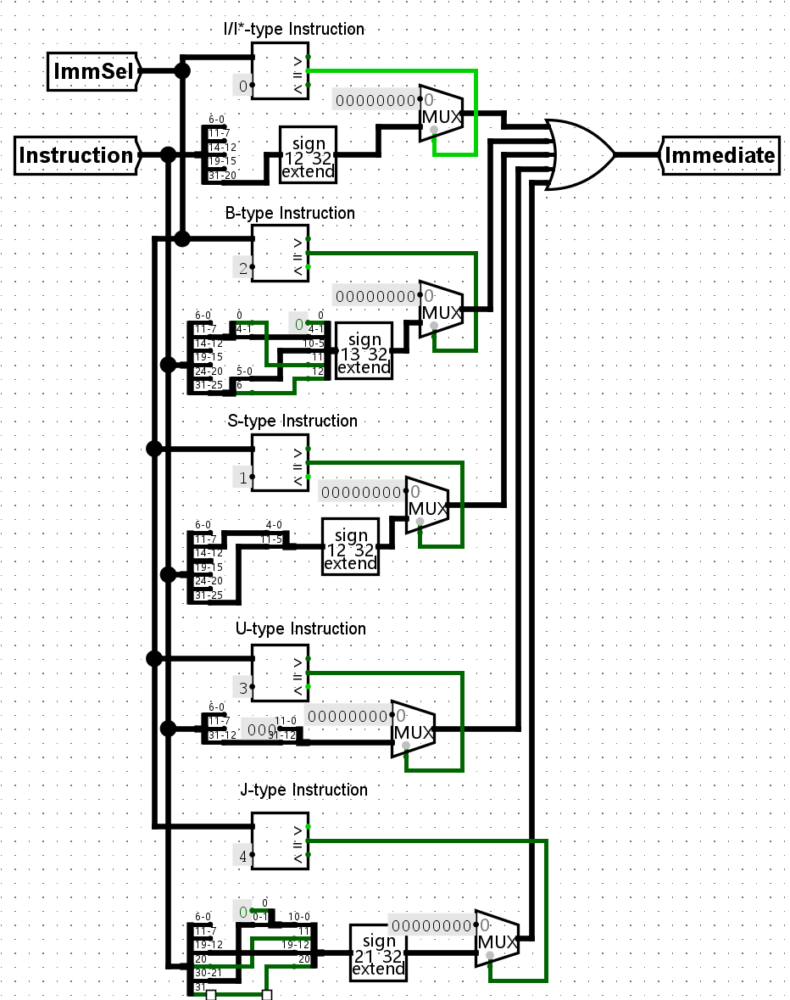
```
(base) PS C:\Users\wsq\Desktop\26WinterDiy\CS61C\Projects\proj3_fa25>  bash test.sh test_imm_gen
PASS: tests/unit-imm-gen/imm-gen-b-type.circ
PASS: tests/unit-imm-gen/imm-gen-i-type-shift.circ
PASS: tests/unit-imm-gen/imm-gen-i-type.circ
PASS: tests/unit-imm-gen/imm-gen-j-type.circ
PASS: tests/unit-imm-gen/imm-gen-s-type.circ
PASS: tests/unit-imm-gen/imm-gen-u-type.circ
Passed 6/6 tests
```
##### Datapath
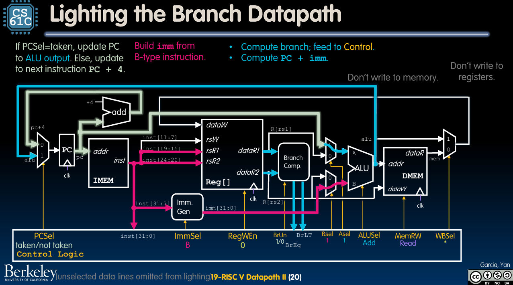
##### CPU
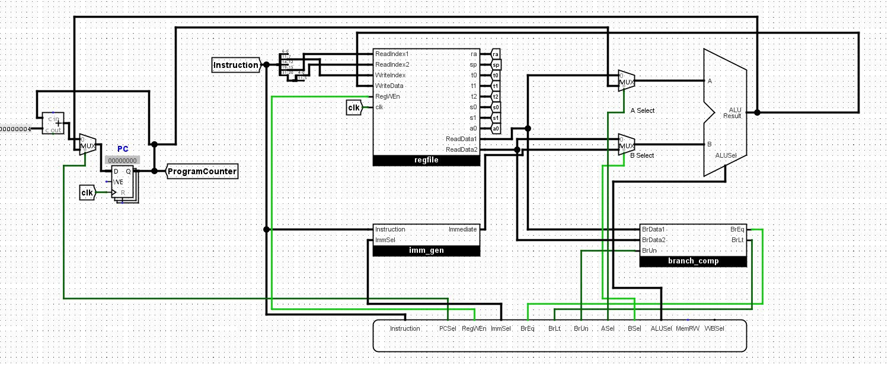
##### ASel/BSel
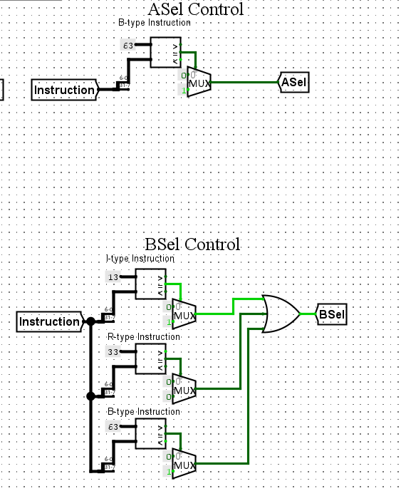
##### ALU Sel 
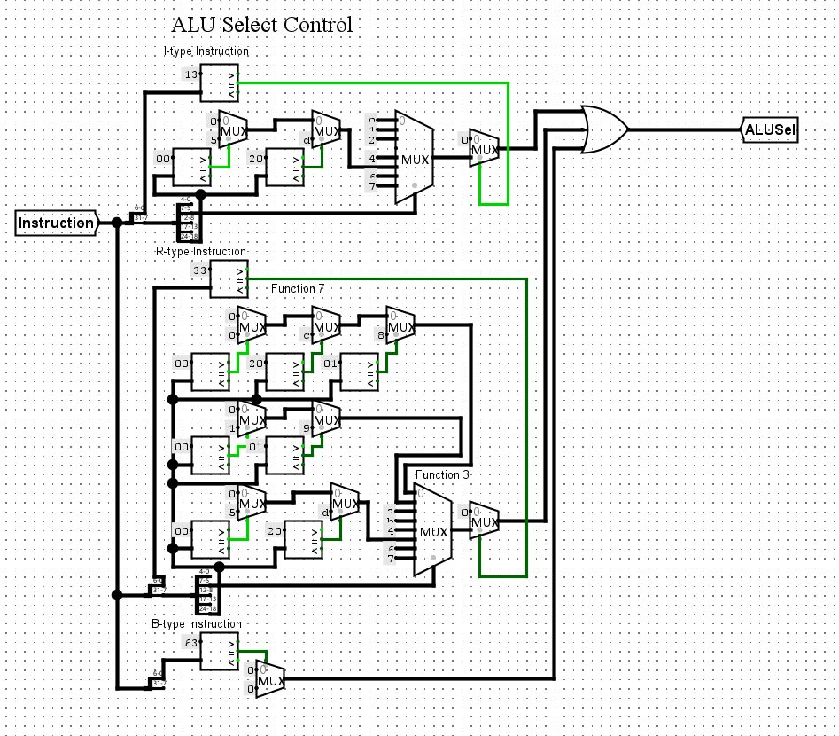
##### BrUn Sel  
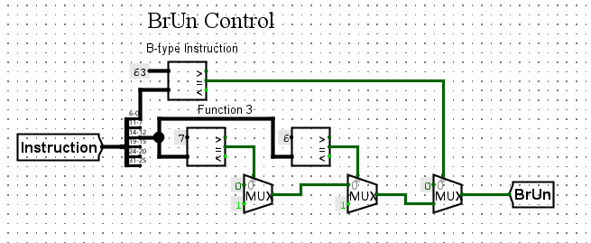
##### ImmSel 
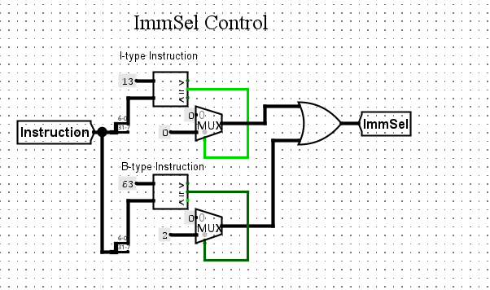
##### PCSel 
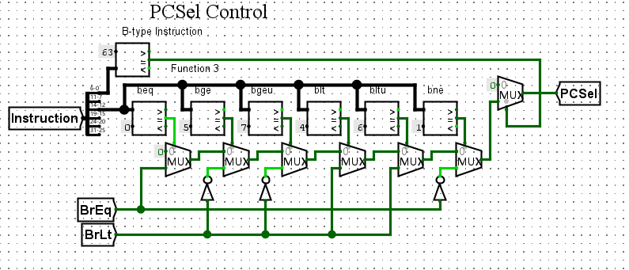
##### RegWEn Control
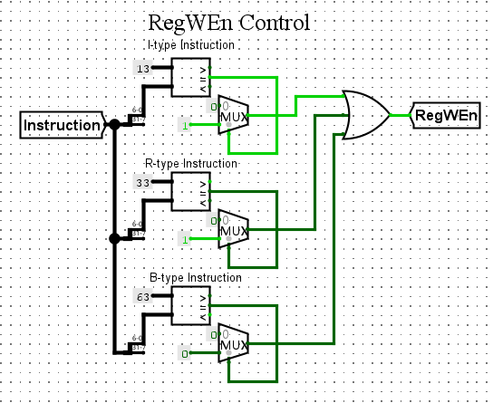 
```
(base) PS C:\Users\wsq\Desktop\26WinterDiy\CS61C\Projects\proj3_fa25> bash test.sh test_integration_branch
PASS: tests/integration-branch/branch-basic.circ
Passed 1/1 tests
```
```
(base) PS C:\Users\wsq\Desktop\26WinterDiy\CS61C\Projects\proj3_fa25> bash test.sh test_custom
PASS: tests/integration-custom/branch_test1.circ
PASS: tests/integration-custom/branch_test2.circ
```
#### Task 8: Loading and Storing
##### Partial Load and Partial Store
**Partial Load**
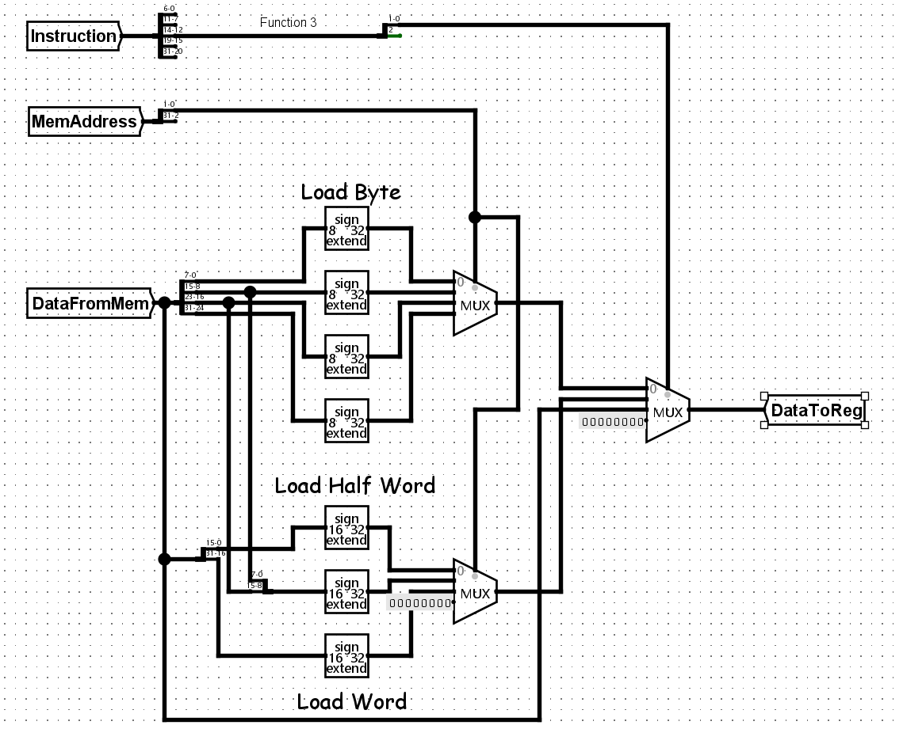

```
(base) PS C:\Users\wsq\Desktop\26WinterDiy\CS61C\Projects\proj3_fa25> bash test.sh test_partial_load
PASS: tests/unit-partial-load/partial-load-byte.circ
PASS: tests/unit-partial-load/partial-load-half.circ
PASS: tests/unit-partial-load/partial-load-word.circ
Passed 3/3 tests
```
**Partial Store**
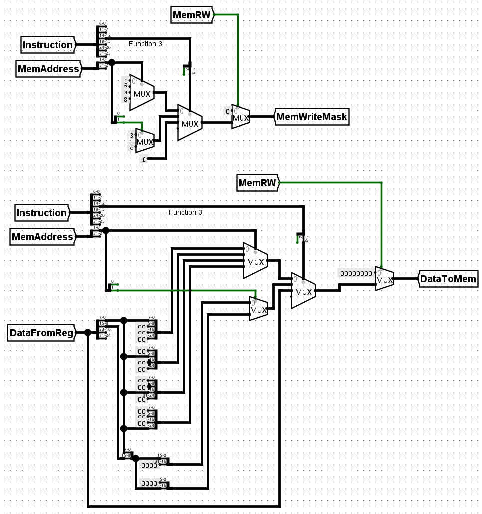

```
(base) PS C:\Users\wsq\Desktop\26WinterDiy\CS61C\Projects\proj3_fa25> bash test.sh test_partial_store
PASS: tests/unit-partial-store/partial-store-byte.circ
PASS: tests/unit-partial-store/partial-store-half.circ
PASS: tests/unit-partial-store/partial-store-non-store.circ
PASS: tests/unit-partial-store/partial-store-word.circ
Passed 4/4 tests
```
##### Control Logic
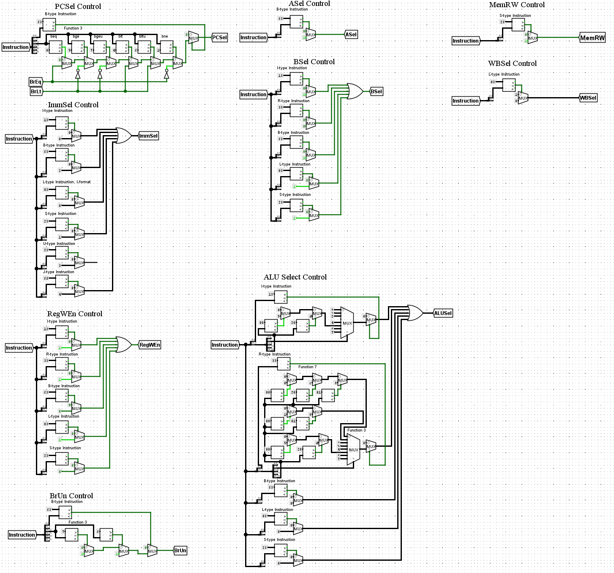
##### Datapath
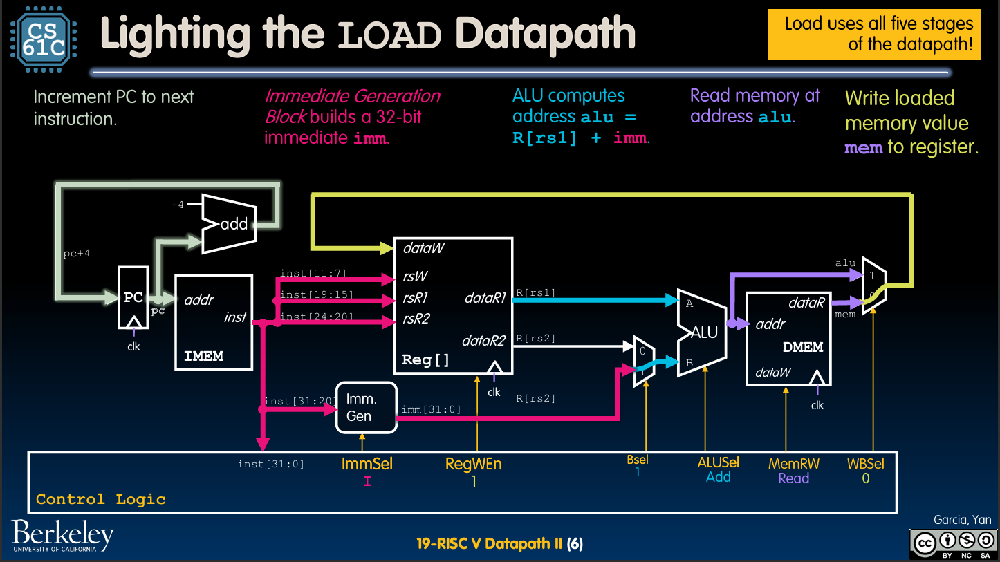

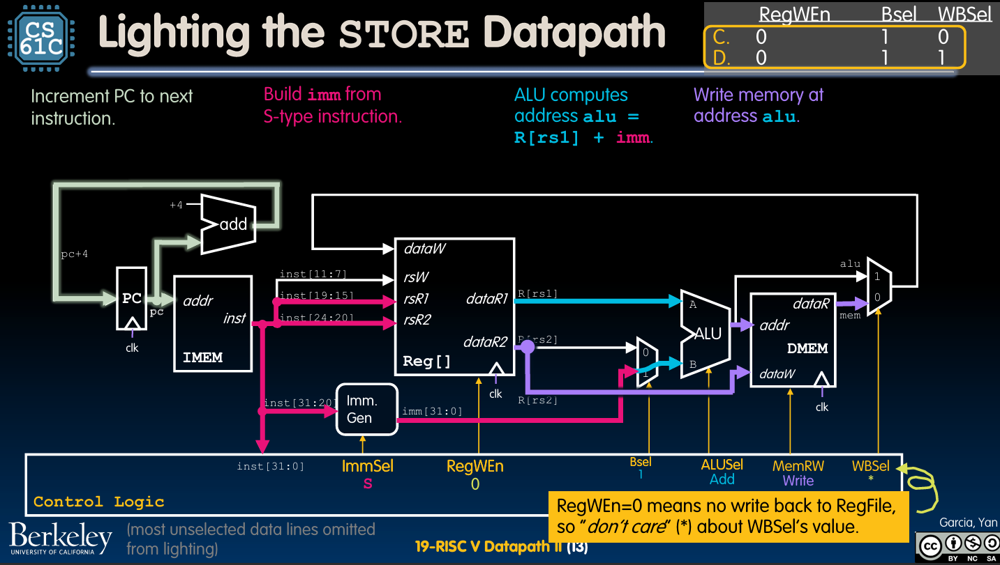

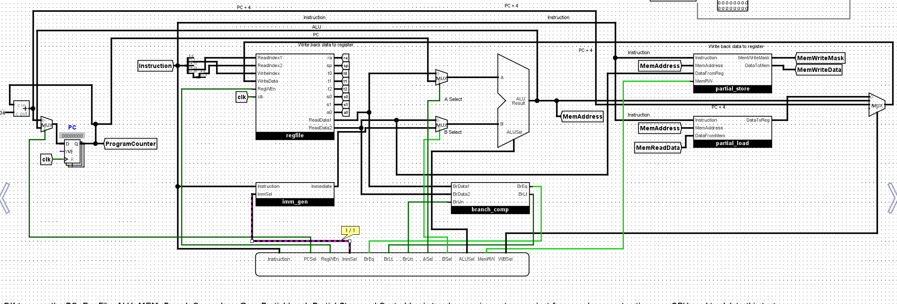
```bash
PASS: tests/integration-custom/l_type.circ
PASS: tests/integration-custom/s_type.circ
```
#### Task 9: Jumps and U-type Instructions

**Control Logic**
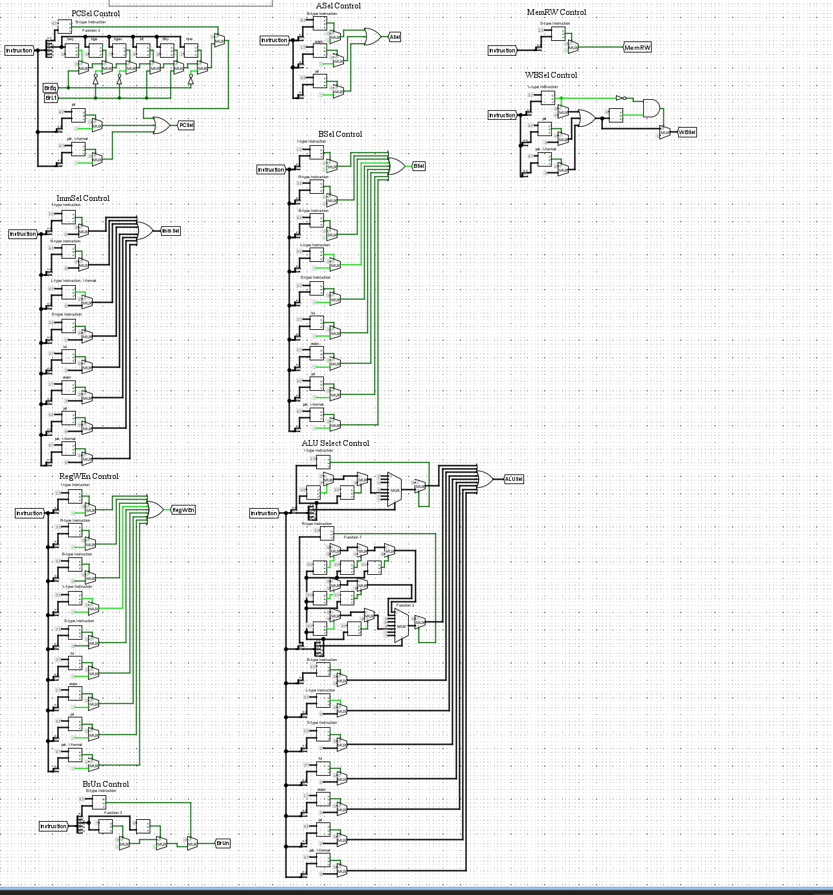
```bash
(base) PS C:\Users\wsq\Desktop\26WinterDiy\CS61C\Projects\proj3_fa25> bash test.sh test_integration_jump
PASS: tests/integration-jump/jump-basic.circ
PASS: tests/integration-jump/jump-empty.circ
PASS: tests/integration-jump/jump-far.circ
Passed 3/3 tests
```
#### Task 10: Pipelining
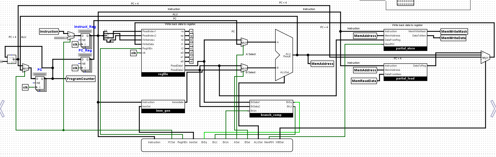
```
(base) PS C:\Users\wsq\Desktop\26WinterDiy\CS61C\Projects\proj3_fa25> bash test.sh run_custom -p
PASS: tests/integration-custom/add.circ
PASS: tests/integration-custom/and.circ
PASS: tests/integration-custom/andi.circ
PASS: tests/integration-custom/branch_test1.circ
PASS: tests/integration-custom/branch_test2.circ
PASS: tests/integration-custom/l_type.circ
PASS: tests/integration-custom/mul.circ
PASS: tests/integration-custom/mulh.circ
PASS: tests/integration-custom/mulhu.circ
PASS: tests/integration-custom/or.circ
PASS: tests/integration-custom/ori.circ
PASS: tests/integration-custom/s_type.circ
PASS: tests/integration-custom/sll.circ
PASS: tests/integration-custom/slli.circ
PASS: tests/integration-custom/slt.circ
PASS: tests/integration-custom/slti.circ
PASS: tests/integration-custom/sra.circ
PASS: tests/integration-custom/srai.circ
PASS: tests/integration-custom/srl.circ
PASS: tests/integration-custom/srli.circ
PASS: tests/integration-custom/sub.circ
PASS: tests/integration-custom/xor.circ
PASS: tests/integration-custom/xori.circ
Passed 23/23 tests
```
```
(base) PS C:\Users\wsq\Desktop\26WinterDiy\CS61C\Projects\proj3_fa25> bash test.sh test_integration_immediates -p
PASS: tests/integration-immediates/immediates-basic.circ
Passed 1/1 tests
(base) PS C:\Users\wsq\Desktop\26WinterDiy\CS61C\Projects\proj3_fa25> bash test.sh test_integration_immediates -p
PASS: tests/integration-immediates/immediates-basic.circ
Passed 1/1 tests
```