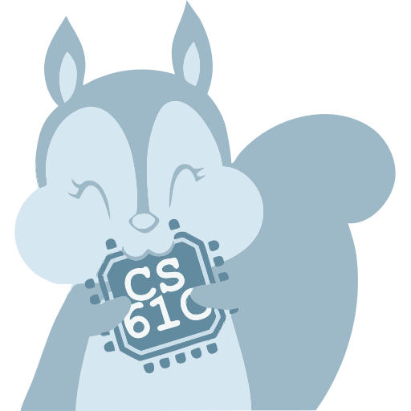

# CS61C_2020Fall

Berkeley [CS 61C](https://cs61c.org/)（Great Ideas in Computer Architecture）的实验、项目和课程资料。实验与项目代码由 Gary Agasa 完成，学期跨 2020 Fall、2022 Fall 和 2025 Fall。

- [CS 61C Fall 2022 课程页面](https://web.archive.org/web/20221212233837/https://cs61c.org/fa22/)
- [CS 61C Fall 2020 课程页面](https://web.archive.org/web/20220120134001/https://inst.eecs.berkeley.edu/~cs61c/fa20/)
- 作业骨架：[61c-teach](https://github.com/61c-teach)

## Labs

2022 Fall，目录在 `Labs/`。Lab 10（OS 与虚拟内存）没有放进本仓库。

| 目录 | 内容 |
| --- | --- |
| `lab00` | 环境与入门 |
| `lab01` | C |
| `lab02` | C 调试 |
| `lab03` | RISC-V 与 Venus |
| `lab04` | RISC-V 调用约定 |
| `lab05` | Logisim |
| `lab06` | CPU 与流水线 |
| `lab07` | Cache |
| `lab08` | SIMD |
| `lab09` | 线程级并行 |

## Projects

| 目录 | 学期 | 内容 |
| --- | --- | --- |
| `Projects/proj1_fa20` | 2020 Fall | Conway's Game of Life |
| `Projects/proj2_fa20` | 2020 Fall | 用 RISC-V 做手写数字分类 |
| `Projects/proj3_fa25` | 2025 Fall | CS61CPU |
| `Projects/proj4_fa22` | 2022 Fall | Numc，SIMD 优化 |

## 其他资料

- `Discussions/`：Discussion 01–11、13 的题目和解答
- `Slides/`：2022 Fall 的一部分课件（不是完整学期）
- `Resources/`：RISC-V 卡片、Cache 和 GDB 参考

课件和 discussion 的版权属于课程教师。本仓库不收录《The C Programming Language》《Computer Organization and Design (RISC-V Edition)》和《The Datacenter as a Computer》的 PDF。

## 录像

- [2022 Fall 课程录像](https://www.bilibili.com/video/BV1MCDPYZEUf)
- [2020 Fall 播放列表](https://www.youtube.com/playlist?list=PL0j-r-omG7i0-mnsxN5T4UcVS1Di0isqf)
